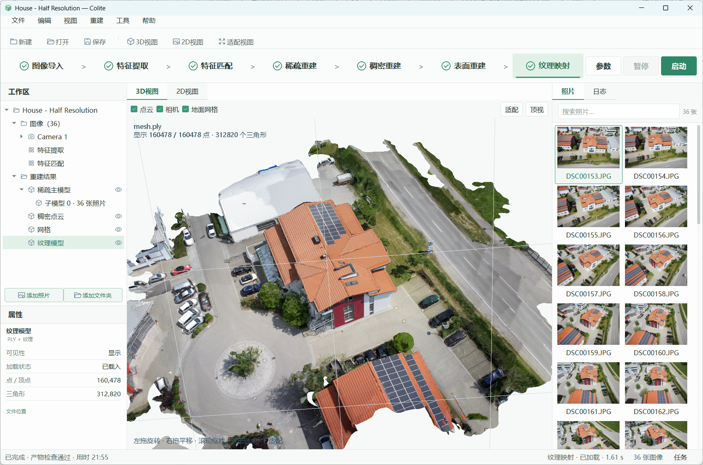

# Colite

[简体中文](README.md) · English

Colite is an open-source photogrammetry project that uses [COLMAP](https://colmap.github.io/) as a reference. Its primary purpose is learning and experimentation. It implements reconstruction from photographs in C++17 and provides a native workbench and command line for Windows and Linux. You can follow the pipeline from keypoints and matches through camera poses, point clouds, and textured meshes, and inspect what each stage produces.

**0.2.0 · 2026-11-15** · [Build and install](INSTALL.md) · [Desktop guide](docs/desktop_user_guide.md) · [CLI reference](docs/cli_reference.md) · [Release notes](docs/release_notes.md) (guides in Chinese)



*The House example uses 36 photographs. The final view combines the geometry of the reconstructed mesh with texture mapped from the photos.*

## Features

The implementation details below use COLMAP 4.0 as the reference.

### Two CUDA SIFT modes

`cuda_vlfeat` and `cuda_opencv` share Colite's CUDA engine for building Gaussian pyramids, detecting DoG extrema, assigning orientations, and computing descriptors on the GPU. The VLFeat mode keeps features by scale layer and follows VLFeat's coordinate and descriptor conventions. The OpenCV mode uses OpenCV-style image border handling, extrema localization, and response-based feature selection. Use `--Colite.feature_extractor` to select a mode. Colite defaults to the VLFeat mode when CUDA SIFT is available and to CPU VLFeat otherwise. COLMAP uses SiftGPU for GPU SIFT. [COLMAP 4.0 SIFT implementation](https://github.com/colmap/colmap/blob/4.0.0/src/colmap/feature/sift.cc)

### CPU feature extraction and threading

Colite provides its own range-based parallel loop API modeled on OpenCV's `parallel_for_`. In the default build, CPU SIFT processes one image at a time and divides work within the image across a reusable thread pool. Nested parallel loops fall back to serial execution. Set `FeatureExtraction.num_threads` to control the thread budget. COLMAP 4.0 links resizing, extraction, and writing with queues and uses multiple CPU SIFT workers to process different images concurrently. Colite's single-image scheduling keeps fewer image pyramids resident at once and aims to reduce memory-related failures or process termination when extracting features from large images on machines with many cores. [COLMAP 4.0 extraction controller](https://github.com/colmap/colmap/blob/4.0.0/src/colmap/controllers/feature_extraction.cc) · [COLMAP documentation on CPU extraction memory](https://colmap.github.io/faq.html#available-functionality-without-gpu-cuda)

### Bundle adjustment (BA)

Colite and COLMAP both use Ceres for conventional BA. Colite uses the same scale constraints in local and global BA and chooses dense, sparse, or iterative Schur solvers based on problem size. It solves on copies of the parameters and writes them back only when the solution is usable, the parameters and cost are finite, and the cost has not increased beyond floating-point tolerance. COLMAP 4.0 passes reconstruction parameter blocks directly to Ceres. Colite's incremental mapper also alternates global BA, track completion and merging, and observation filtering until it reaches an observation-change threshold or an iteration limit. [COLMAP 4.0 Ceres BA](https://github.com/colmap/colmap/blob/4.0.0/src/colmap/estimators/bundle_adjustment_ceres.cc)

### PatchMatch dense reconstruction

COLMAP 4.0 uses CUDA for PatchMatch Stereo. Colite provides CPU and CUDA implementations that estimate depth using bilaterally weighted normalized cross-correlation (NCC), source-view selection, and geometric consistency. COLMAP interleaves hypothesis, photometric cost, and view-selection updates during directional sweeps. Colite batches the row and column HMM message updates after an optimization iteration, and its CPU implementation aggregates costs from the best-scoring source views (best-K). Even with the same inputs and filter thresholds, sampling and update order can affect the resulting depth maps. [COLMAP 4.0 PatchMatch CUDA](https://github.com/colmap/colmap/blob/4.0.0/src/colmap/mvs/patch_match_cuda.cu) · [Colite CLI reference](docs/cli_reference.md)

The workbench can run and inspect each stage separately. Colite uses a file-based workspace, reads and writes COLMAP sparse BIN / TXT models, and provides offline tools for exchanging features, matches, and verified geometry. For availability of global and hierarchical mapping, ONNX features and matching, and Delaunay meshing, see the [CLI reference](docs/cli_reference.md) and [build guide](INSTALL.md). See [architecture and pipeline](docs/architecture_and_pipeline.md) for the source layout.

## Quick start

### Desktop workbench

1. Follow the [build and install guide](INSTALL.md). Launch `colite_gui.exe` on Windows or `colite_gui` on Linux. The workbench uses the native Colite engine on each platform.
2. Add photos or a folder of JPEG / PNG images taken from different angles with sufficient overlap. You can start with an untitled project and save it later as a `.colite.json` file.
3. In the parameter dialog, check that the workspace is writable. With the image import stage selected, Start runs the pipeline through texturing. Select a stage and run or rerun it from the parameter dialog to experiment with its settings.
4. Use the **2D view** to inspect photos, features, and matches. Use the **3D view** to inspect cameras, point clouds, meshes, and textures. Export the current model from the **File** menu.

The project JSON records photo references, workspace paths, and parameters. Keep the source photos and workspace when archiving a project. By default, the workbench estimates depth at half the undistorted image width and height, while texturing can still read the full-resolution images. To compare detail and runtime, try two depth resolutions with the same photos and sparse model.

### Command line

With `colite` on PATH, run the full CPU pipeline using your own photo directory. On Windows, `colite.exe` accepts the same arguments. Run `colite --capabilities` to see which optional algorithms and accelerators are available in your build.

```bash
colite recon_auto --image_path /path/to/photos --output_path output/example --mvs.Colite.patch_match_backend cpu --mesher poisson --simplify 1 --texture 1
```

| Path relative to `--output_path` | Contents |
| --- | --- |
| `sfm/` | Cameras, registered images, sparse points, and COLMAP model files |
| `mvs/stereo/`, `mvs/fused.ply` | Depth and normal maps, plus the fused colored cloud |
| `surface/` | Triangle mesh and simplified output |
| `surface/textured/` | Textured PLY and PNG atlas |

Run `colite recon_auto --help` for pipeline options. Use `--resume` to validate and reuse existing stages in the same output directory. Use `--start_from` and `--stop_after` to run a subset of stages when the upstream files are available.

## License and acknowledgments

Thanks to the COLMAP team and contributors. Colite takes its SfM / MVS pipeline, some algorithm designs, and data formats from COLMAP as references. It also adapts portions of upstream code and retains their copyright and license notices. Colite uses the [BSD 3-Clause License](LICENSE). See [third-party notices](THIRD_PARTY_NOTICES.md) for attribution and component licenses.
