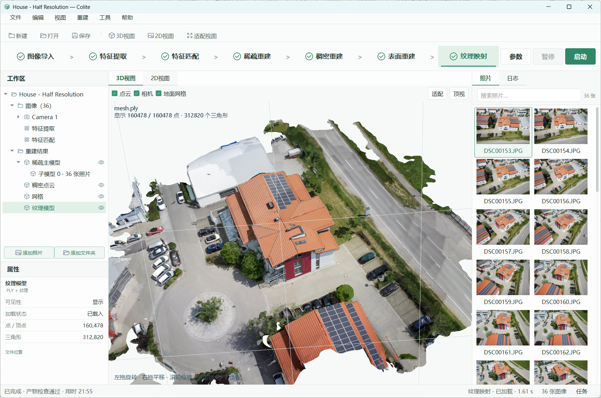

# Colite

简体中文 · [English](README.en.md)

**colite** 是一个参考 [COLMAP](https://colmap.github.io/) 实现的开源三维重建项目，主要用于三维重建算法的学习和实验。使用 C++17 实现从多张照片到三维模型的重建流程，提供 Windows / Linux 原生桌面工作台和命令行。

**0.2.0 · 2026-11-15** · [构建与安装](INSTALL.md) · [桌面使用](docs/desktop_user_guide.md) · [命令行参考](docs/cli_reference.md) · [版本说明](docs/release_notes.md)



*House 示例使用 36 张照片生成纹理网格。模型细节来自网格几何与映射到表面的照片纹理。*

## 功能介绍

以下实现对照以 COLMAP 4.0 为基准。

### 两种 CUDA SIFT

`cuda_vlfeat` 和 `cuda_opencv` 共用 Colite 的 CUDA 引擎，在 GPU 上完成高斯金字塔、DoG 极值检测、主方向估计和描述子计算。区别在于算法规则：VLFeat 模式按尺度层保留特征，并对齐 VLFeat 的坐标与描述子约定。OpenCV 模式采用 OpenCV 风格的边界处理、极值定位和按响应排序的特征筛选。可用 `--Colite.feature_extractor` 显式切换。CUDA SIFT 可用时，Colite 默认选 VLFeat 模式，否则使用 CPU VLFeat。COLMAP 的 GPU SIFT 使用 SiftGPU。[COLMAP 4.0 SIFT 实现](https://github.com/colmap/colmap/blob/4.0.0/src/colmap/feature/sift.cc)

### CPU 特征提取与多线程

Colite 自带类似 OpenCV `parallel_for_` 的区间并行接口。默认构建的 CPU SIFT 逐张处理图像，把单图内的计算拆给可复用的线程池。嵌套并行区回退到串行，线程数可通过 `FeatureExtraction.num_threads` 调整。COLMAP 4.0 的 CPU SIFT 在控制器层通过队列串联缩放、提取和写入，由多个提取工作线程并行处理不同照片。Colite 的单图并行减少了同时驻留的图像金字塔，旨在降低多核机器处理大图时因内存压力导致提取失败或异常退出的风险。[COLMAP 4.0 提取调度](https://github.com/colmap/colmap/blob/4.0.0/src/colmap/controllers/feature_extraction.cc) · [COLMAP 关于 CPU 提取内存的说明](https://colmap.github.io/faq.html#available-functionality-without-gpu-cuda)

### 光束法平差（BA）

Colite 和 COLMAP 的经典 BA 都使用 Ceres。Colite 在局部 BA 和全局 BA 中使用统一的尺度约束，并按问题规模选择稠密、稀疏或迭代 Schur 求解。Colite 在参数副本上求解，只在求解结果可用、参数和代价均为有限值、且最终代价不高于初始代价（考虑浮点容差）时写回。COLMAP 4.0 则直接把重建中的参数块交给 Ceres。Colite 的增量建图还会交替执行全局 BA、轨迹补全与合并、观测过滤，并按观测变化率或轮数上限结束细化。[COLMAP 4.0 Ceres BA](https://github.com/colmap/colmap/blob/4.0.0/src/colmap/estimators/bundle_adjustment_ceres.cc)

### PatchMatch 稠密重建

COLMAP 4.0 的 PatchMatch Stereo 使用 CUDA。Colite 提供 CPU 和 CUDA 路径，使用双边加权归一化互相关（NCC）、源视图选择和几何一致性估计深度。两者的更新顺序不同：COLMAP 在方向扫描中交替更新深度与法线假设、光度代价和视图选择消息。Colite 将行列方向的 HMM 消息更新放在一轮优化后批量执行，CPU 路径用代价较低的一组源视图（best-K）聚合候选代价。即使输入与过滤阈值相同，采样和更新顺序也会影响输出深度图。[COLMAP 4.0 PatchMatch CUDA](https://github.com/colmap/colmap/blob/4.0.0/src/colmap/mvs/patch_match_cuda.cu) · [Colite 参数与实现说明](docs/cli_reference.md)

桌面端支持逐阶段运行和检查产物。Colite 使用文件工作区，支持 COLMAP 稀疏模型 BIN / TXT 读写，并提供离线工具交换特征、匹配和已验证几何。可用的全局式与分层重建、ONNX 特征和匹配、Delaunay 等选项见[命令行参考](docs/cli_reference.md)与[构建说明](INSTALL.md)。源码分层见[架构与重建流程](docs/architecture_and_pipeline.md)。

## 快速开始

### 桌面工作台

1. 按[构建与安装](INSTALL.md)准备程序。Windows 启动 `colite_gui.exe`，Linux 启动 `colite_gui`。工作台调用同平台的 Colite 引擎。
2. 点击**添加照片**或**添加文件夹**，选一组从不同角度拍摄且具有足够重叠的 JPEG / PNG 照片。可先在未命名工程中操作，再保存为 `.colite.json`。
3. 在**参数**确认可写的工作目录。从**图像导入**点击**启动**可运行到纹理映射。想做逐阶段实验时，选中节点，在参数页单独运行或重跑。
4. 在 **2D 视图**查看照片、特征和匹配，在 **3D 视图**查看相机、点云、网格和纹理。通过**文件 → 导出当前模型**保存结果。

工程 JSON 记录照片引用、工作路径和参数。归档工程时一起保留照片与工作目录。GUI 默认以去畸变图像的一半宽、一半高估计深度，纹理映射仍可读取原分辨率。想对比速度和细节，可以只修改深度图尺寸，用相同照片和稀疏模型分别运行两次。

### 命令行

将 `colite` 加入 PATH 后，用下面的命令运行完整 CPU 流程，将示例路径替换为自己的照片目录。Windows 可用 `colite.exe` 运行相同参数。用 `colite --capabilities` 查看当前构建有哪些可选算法和加速后端。

```bash
colite recon_auto --image_path /path/to/photos --output_path output/example --mvs.Colite.patch_match_backend cpu --mesher poisson --simplify 1 --texture 1
```

| 输出路径（相对于 `--output_path`） | 内容 |
| --- | --- |
| `sfm/` | 相机、注册图像、稀疏点和 COLMAP 模型文件 |
| `mvs/stereo/`、`mvs/fused.ply` | 深度及法线图、融合后的彩色点云 |
| `surface/` | 三角网格及简化结果 |
| `surface/textured/` | 带纹理的 PLY 和 PNG 图集 |

使用 `colite recon_auto --help` 查看流程选项。`--resume` 可检查并复用当前输出目录中的有效阶段，`--start_from` 和 `--stop_after` 可在上游产物已存在时限定运行范围。

## 许可与致谢

感谢 COLMAP 团队及其贡献者。Colite 参考了 COLMAP 的 SfM / MVS 流程、部分算法和数据格式，也适配了部分上游源码，保留相应的版权和许可。Colite 采用 [BSD 3-Clause](LICENSE) 许可，具体来源和第三方组件见[第三方声明](THIRD_PARTY_NOTICES.md)。
