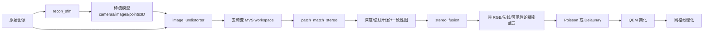

# Colite 架构与重建流程

## 桌面工作台与计算引擎

Qt 桌面端位于 `gui/`。

| 目录 | 职责 |
| --- | --- |
| `app/` | 程序入口、主窗口及界面编排 |
| `widgets/` | 2D / 3D 视图、属性面板和参数对话框 |
| `project/` | 工程、恢复草稿、工作区及模型导出 |
| `workflow/` | 参数定义、任务计划、进程执行、阶段状态和产物校验 |
| `assets/` | 图标、样式和 Qt 资源清单 |

桌面端负责工程管理、参数配置、阶段队列、日志与可视化。工作台按节点准备任务，使用同平台安装目录中的 `colite` 子进程执行；算法与文件格式由 `src/colite/` 和 `include/colite/` 实现。CLI 可独立运行同一套算法。暂停和中止由任务队列及进程管理实现，浏览器和 WSL 均非桌面运行依赖。

项目文件仅记录照片引用、参数和工作路径。独立运行目录保留阶段产物，同路径缓存由输入与参数的指纹校验。图像或参数变化后，下游结果需要重新验证或计算。显示使用独立的预览预算，不改写重建产物。操作方法见[桌面使用说明](desktop_user_guide.md)。

## 总体分层



稳定的流程边界为：

- `recon_sfm`：原始图像到注册稀疏模型。
- `recon_mvs`：稀疏模型和图像到 dense maps、融合点云和可选表面产物。
- `recon_auto`：从原始图像组合全部独立 stage，默认生成 Poisson 简化纹理网格。

图像去畸变不是几何 SfM 求解的一部分，而是把稀疏模型转换成 MVS 可直接使用的针孔图像 workspace，因此归属 MVS 第一阶段。

## 代码职责

| 目录 | 职责 | 不应包含 |
|---|---|---|
| `core` | 基础 ID、Camera/Image/Point、Pose、Reconstruction、几何和持久线程池 | CLI 参数解析、具体流程编排 |
| `features` | SIFT 后端和统一 `FeatureSet` | pair 选择和两视图几何 |
| `matching` | pair generator、描述子匹配、guided matching、E/F/H 验证 | Mapper 状态 |
| `sfm` | 初始化、注册、三角化、BA、观测管理 | 图像解码和 MVS |
| `mvs` | MVS workspace、PatchMatch、Fusion、网格和纹理 | 命令行别名和 manifest |
| `io` | COLMAP/workspace/PLY 等持久化 | 算法策略 |
| `controllers` | 把算法模块组成单个可执行阶段 | 重复实现算法内核 |
| `exe` | CLI、stage manifest、`recon_auto` 编排 | 大型数学算法 |

## 核心数据结构

- `Camera`：相机模型、尺寸和参数；投影/反投影由统一相机 API 完成。
- `Image`：图像 ID、相机 ID、名称、原始路径、可选位姿、位置先验和 `Point2D`。
- `Point2D`：像素坐标、feature 索引和可选 `Point3DId`。
- `Point3D`：世界坐标、RGB、重投影误差和观测 `Track`。
- `Reconstruction`：Camera/Image/Point3D 的所有权、注册图像集合和一致性修改接口。
- `MatchGraph`：每图特征、原始匹配和已验证两视图几何。
- `MvsImage`：PatchMatch 使用 `[0,1]` 的 `CV_32FC1` 灰度图，Fusion 同时使用 `CV_8UC3` RGB 图。
- `FusedPoint`：三维坐标、法线、RGB、seed 像素和可见图像集合。

像素坐标遵循 COLMAP 的左上像素中心 `(0.5, 0.5)` 约定；与 OpenCV 的 `(0, 0)` 像素中心互换时必须显式偏移。稀疏点 RGB 按 COLMAP 4.0 方式从所有有效 track 观测做双线性采样并求均值；Fusion 对轨迹颜色取稳健统计。

## SfM 单步骤 workspace

`feature_extractor`、matcher 和 `mapper` 通过文件 workspace 解耦：

```text
SFM_WORKSPACE/
  cameras.txt
  images.tsv
  features/<image_id>.bin
  matches/raw_matches.tsv
  matches/verified_matches.tsv
  matches/summary.txt
  sparse/
    cameras.txt
    images.txt
    points3D.txt
    points3D.ply
    summary.txt
    models.txt
    models/
      0/
        cameras.txt
        images.txt
        points3D.txt
        points3D.ply
      1/
        ...
```

`sparse/` 根目录始终保留注册图像最多的主模型，以兼容既有 MVS 输入；所有模型按规模排序写入
`sparse/models/<index>/`，`models.txt` 是模型索引。特征、匹配、几何和 sparse
阶段使用配置 hash 缓存，缓存会校验每个编号模型的完整输出。修改算法语义时必须更新对应的
`algorithm_version`，否则可能误用旧缓存。性能测试必须使用新的 workspace 或明确清理对应
stage 缓存。

新写入的 feature v3 以原始 2/4/6 列形状元数据补充内部五字段关键点，校验和覆盖形状及描述子；
内部提取器不分配逐点外部形状矩阵。v1/v2 可读，延迟描述子数据源按实际形状区段计算偏移。
离线工具可在该 workspace 与 COLMAP 4 数据库之间双向交换特征、raw 和新版 verified。
数据库 schema 由实际 COLMAP 创建，Colite 运行时存储没有迁移。verified v2 在同一个 TSV
中按 pair 保存 F/E/H、相对位姿和 presence bits，内点行保持 13 列；空对、configuration
和缺失字段均保留，完整验证文件后才更新图。反向 pair 同步交换索引、转置 E/F、求逆 H/位姿。
旧 verified 只能读取，不能作为完整 verified 反向导出。mapper 在内存中恢复缺失的
CALIBRATED/UNCALIBRATED 的 E/F 位姿、平面/全景的 H 位姿及视差，不更改源文件。
匹配默认 compute_relative_pose=false；PLANAR_OR_PANORAMIC 在恢复位姿后才分为平面或全景，
纯旋转不进入平移初始化。初始化接受有非零基线位姿的标定、未标定和平面对。

## MVS 与完整流程产物

```text
OUTPUT/
  sfm/
    cameras.txt
    images.txt
    points3D.txt
    points3D.ply
  mvs/
    images/
    sparse/
    images.tsv
    stereo/
      depth_maps/
      normal_maps/
      cost_maps/
      consistency_graphs*/
      patch_match.tsv
    dense/
      fusion_tracks.tsv
    fused.ply
    fused.ply.vis
  surface/
    meshed-poisson.ply 或 meshed-delaunay.ply
    mesh-simplified.ply
    textured/
      mesh.ply
      texture.png
  .colite/stages/
    <stage>.json
```

Dense map 默认保存标准 photometric/geometric binary；TXT 和 cost map 仅作为显式调试输出。
`stereo_fusion` 只读取已存在的深度、法线图，不会隐式重跑 PatchMatch；持久化几何过滤已经把无效掩码同步写入 depth/normal。
Fusion 文件与 sparse/ 同级，工作区可直接被两端 dense Delaunay 消费；附加诊断、清理点云和
组合 MVS 的表面产物仍可放在 dense/。独立 sparse Delaunay 直接从 COLMAP 模型轨迹建图。
纹理 PLY 默认 BIN，可选 TXT，引用 PNG；OBJ/MTL 只在启用 Colite 扩展时附加写出。

## Stage manifest

以下独立命令支持 `--resume`、`--force` 和 `--dry_run`：

- `image_undistorter`
- `patch_match_stereo`
- `stereo_fusion`
- `poisson_mesher`
- `delaunay_mesher`
- `mesh_simplifier`
- `mesh_texturer`

manifest 保存 schema、状态、输入指纹、参数指纹、耗时和声明输出。只有指纹一致且所有声明输出存在时，`--resume` 才跳过；`--force` 强制执行；二者互斥。`--dry_run` 只打印计划，不读取或写入重建产物。

光度图复用由 MVS 控制器单独管理，独立命令、组合命令和库调用共用
`.colite/photometric_cache.txt`。身份采用解析后的参数、源列表、稀疏初值、相机和图像文件，
不依赖命令名称或参数排列；Fusion 参数不进入光度身份。执行前写 running，全部成功后
原子替换 complete，并保存自有 photo depth/normal 的文件指纹。独立 PatchMatch stage
也把该记录纳入输出指纹，防止恢复时跳过未完成的替换。旧 Colite 产物缺少可信记录时重算，
全新外部工作区仍可借用标准 photometric maps；公开数据格式不变。

SfM 的 `workspace/cache/*.txt` 使用私有 schema 2：缓存清单以完整标记和FNV校验
结束，临时文件关闭成功后原子发布；声明的文件及目录递归记录大小/修改时间指纹。
旧、截断或被改写的清单按缓存未命中处理。matching/geometry/sparse的声明包含其
特征、相机和图像清单依赖；组合SfM还检查原始/验证匹配、子模型、双格式产物与
子缓存记录。feature重算后不能复用旧frontend，缓存标记在输出流关闭后保存。
`recon_auto` 外层也检查这些产物，`resume/force`控制旗标不参与其阶段身份。
这保持COLMAP数据格式与算法不变；指纹使用文件元数据，未逐字节校验所有产物内容。

组合SfM分别维护matching与geometry身份：`raw_matches.tsv`只保存首次描述子匹配，
guided更新只进入verified几何。matching身份包含特征、匹配后端/阈值及配对控制；
geometry身份继续包含matching身份、求解构建能力、两视图与guided参数。
因此仅改变几何参数或求解构建时保留raw，改变匹配阈值或特征时逐层重算；
删除/截断raw同样重算匹配，删除verified则只重算几何。CUDA流水线移动其initial
对应缓冲，CPU在guided前保存raw，冷/热诊断都读取canonical raw语义。
日志分别报告`Raw match cache hit`与`Geometry cache hit`，不新增用户参数。

`ImageReader.mask_path`与`ImageReader.camera_mask_path`共用特征后处理，保留相同的
关键点/描述子/原始shape行。遮罩按编码原图坐标采样，Colite内部的EXIF朝向变换会
先映回该坐标；不缩放遮罩，不在过滤后补足特征预算。遮罩内容指纹进入feature身份并
逐级传递到匹配、几何和重建，Auto也在计划/跳过前验证并计算内容身份。
图像的逻辑相对路径用于遮罩名称、模型图名及按目录相机分组，符号链接的物理目标不改写这些名称。

## SfM 数据流

1. 递归枚举图像并保留相对路径，解码每张图像的尺寸及 EXIF Make、Model、
   35 mm 等效焦距、物理焦距和焦平面分辨率。默认 Auto 模式按
   `Make + Model + 焦距标识 + width + height` 分组；元数据不完整的图像不与
   其他图像猜测共享。可选 Single、Per-folder、Per-image；随后提取统一
   `FeatureSet`。
2. pair generator 生成 exhaustive/sequential/spatial/vocabulary 候选。
3. BF/FLANN 匹配，执行 ratio、cross-check、两视图几何和 guided rematch。
4. 增量模式由 Reconstruction Manager 按 verified 图的连通分量运行 Incremental Mapper；若提供已有
   COLMAP text model，则先按图像名重映射 ID，恢复位姿、内参、点和 track，再继续注册新增或
   尚未注册的图像。
5. `IncrementalTriangulator` 先 Continue，再用 point-centric multi-view Create 建点。
6. track complete/merge、局部 BA、过滤和全局 BA 交替执行。
7. 不同局部模型间若能从 verified 匹配建立足够的 3D-3D 对应，则用鲁棒 Sim(3) 对齐并合并
   图像、点和观测，再执行一次增量补注册及全局精化；不能可靠对齐的模型保持独立。
8. 从所有注册观测提取稀疏点 RGB，分别导出多个 COLMAP text model 和 PLY，并将最大模型同步
   写到兼容根目录。

全局模式根据已验证的相对位姿建立位姿图，执行旋转平均、位置估计、轨迹三角化和全局 BA。全局模式使用已匹配的工作区重新求解，不接续已有稀疏模型。CLI 还提供分层模式；其构建能力和参数见[命令行参考](cli_reference.md)。

## MVS 数据流

1. `image_undistorter` 生成 PINHOLE 相机和去畸变彩色图像，并重投影稀疏观测。
2. source-view scoring 结合共享稀疏点、尺度和覆盖率选择视图。
3. CPU/CUDA PatchMatch 估计深度、法线和代价；可启用 bilateral NCC、动态 source probability、directional HMM、CDF source sampling 和几何 refinement。
4. consistency graph 记录每像素的几何一致来源。
5. Fusion 从 seed 出发遍历互相一致的观测，稳健融合位置、法线和 RGB，同时写出可见性。
6. Poisson 使用有向点云；Delaunay 额外使用相机到点的可见射线。
7. QEM 简化保持拓扑和法线约束；Texturer 做视图选择、BVH 遮挡、patch 分组、图集打包、颜色校正和烘焙。

## 流程扩展原则

- 新模块先实现独立控制器和测试，再接入 CLI stage，最后接入 `recon_auto`。
- 一个算法只保留一套参数解析语义；薄包装命令应转发到现有控制器。
- stage 必须明确输入、输出和缓存指纹，不能通过隐式目录猜测修改上游产物。
- 几何结果与显示属性分离：RGB/纹理变化不得影响位姿、深度或网格拓扑判定。
